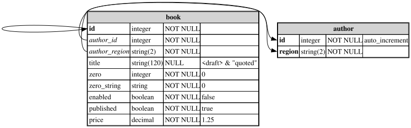

<p align="center">
  
</p>

<h1 align="center">doctrineviz</h1>

<p align="center">
  <strong>Your database schema, drawn.</strong><br>
  Doctrine DBAL · Graphviz, Mermaid and PlantUML · SVG, PNG and PDF · Symfony bundle
</p>

<p align="center">
  <a href="https://github.com/janalis/doctrineviz/actions/workflows/ci.yml"></a>
  <a href="https://janalis.github.io/doctrineviz/"></a>
  <a href="https://github.com/janalis/doctrineviz/releases"></a>
  <a href="https://packagist.org/packages/janalis/doctrineviz"></a>
  <a href="LICENSE"></a>
</p>

<p align="center">
  <a href="https://janalis.github.io/doctrineviz/"><strong>Documentation</strong></a> ·
  <a href="https://janalis.github.io/doctrineviz/guide/installation">Installation</a> ·
  <a href="https://janalis.github.io/doctrineviz/guide/usage">Command reference</a> ·
  <a href="https://janalis.github.io/doctrineviz/guide/migration">Migration</a>
</p>

---

doctrineviz reads your database schema through Doctrine DBAL and generates a
Graphviz, Mermaid or PlantUML diagram with tables, columns, primary keys and
foreign keys, or renders it straight to SVG, PNG or PDF with
[viz](https://janalis.github.io/viz/), natively in PHP. Run it in a Symfony
application, or use the exporter directly with a DBAL schema. Doctrine ORM is optional.

## Install

```sh
composer require --dev janalis/doctrineviz
```

Register `Janalis\Doctrineviz\DoctrinevizBundle::class` for the `dev` and
`test` environments in `config/bundles.php`. Requires PHP 8.5+, Symfony
7.4 or 8.x, DoctrineBundle 3.3+, and DBAL 4.5+.
See [Installation](https://janalis.github.io/doctrineviz/guide/installation).

## Quick start

```sh
php bin/console doctrine:schema:graphviz --output=schema.svg      # drawn natively, no Graphviz needed
php bin/console doctrine:schema:graphviz --output=schema.pdf
php bin/console doctrine:schema:graphviz --format=mermaid > schema.mmd
php bin/console doctrine:schema:graphviz --format=plantuml > schema.puml
php bin/console doctrine:schema:graphviz > schema.dot
```



## Highlights

- **Database schema diagrams** show the actual schema, including tables not mapped by ORM.
- **Three languages**: Graphviz DOT, a Mermaid `erDiagram` and a PlantUML entity diagram, with cardinalities.
- **Images without tools**: `--output=schema.svg|png|pdf` renders natively; `--engine=cli` uses `dot`, `mmdc` or `plantuml` instead.
- **Column details** include DBAL type, length, nullability, defaults and auto-increment.
- **Relationships** preserve composite foreign-key column pairs and self-references.
- **Named connections** through `--connection=reporting`.
- **Optional Gedmo links** through `--infer-gedmo-translations` and `--infer-gedmo-logs`.
- **Reusable exporter** accepts a DBAL `Schema` without booting Symfony.

## Contributing

Read [CONTRIBUTING.md](CONTRIBUTING.md) and the
[development guide](https://janalis.github.io/doctrineviz/contributing/development).
Use synthetic schemas in reports and tests; redact connection details and private data.

```sh
make install
make verify    # formatting, lint, analysis, workflows, tests, 100% coverage and MSI
make docs      # build the VitePress documentation
make help      # list all developer commands
```

## License

[BSD-3-Clause](LICENSE).
